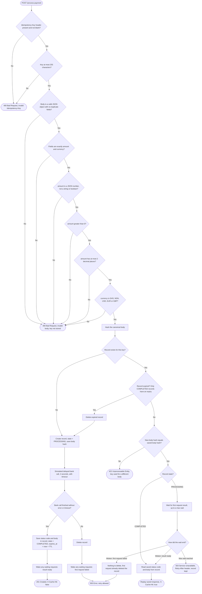

# Silk Idempotency Gateway

A payment-processing API that charges each payment **at most once**, no matter how many times a client retries the same request.

## Overview

### The problem

When a customer clicks "Pay", the online store's server sends a payment request to the payment processor. If the network times out, the store cannot tell what happened. The request may have been lost before it arrived, or the payment may have gone through and only the response was lost. The store's server retries the request automatically (and the customer may also click "Pay" again). If the payment processor treats the retry as a new payment, the customer is charged twice.

### The solution

Every payment request carries an `Idempotency-Key` header: a unique id the client creates once per payment and sends again with every retry of that payment. The gateway remembers each key and what happened to it:

- **First request with a key:** the payment is processed (a simulated delayed bank call that takes 2 seconds), the response is saved, and `201 Created` is returned.
- **Retry with the same key and the same body:** the saved response is returned immediately with the header `X-Cache-Hit: true`. The payment is not processed again.
- **Same key with a different body:** rejected with `422 Unprocessable Entity`, so a key can never confirm a payment it was not created for.
- **Retry that arrives while the first request is still processing:** it waits for the first request to finish and returns the same result.

Completed keys are forgotten after 24 hours by default, and a background task removes them every 60 seconds, so memory does not grow forever. This is the Developer's Choice feature.

### Tech stack

| Component | Used for |
|---|---|
| Python 3.12 | Language |
| FastAPI | Web framework: routes requests to the endpoint and generates the interactive API docs |
| Uvicorn | Server: listens for HTTP requests and runs the event loop |
| pytest, httpx | Automated tests, including simultaneous requests |

Keys are kept in memory, in a Python dictionary. There is no database.

## Architecture

### Request flow

Every path starts when a request arrives and ends with exactly one HTTP response.

### Validation rules

Checks run in this order. The first one that fails returns `400 Bad Request` with a JSON body of the form `{"error": "<what went wrong>"}`, and nothing is stored for the key.

| Check | Rule |
|---|---|
| Idempotency key | `Idempotency-Key` header is present, not blank, and at most 255 characters |
| JSON | Body is a valid JSON object with no duplicate fields. `NaN` and `Infinity` are rejected |
| Fields | Exactly `amount` and `currency`, no other fields |
| Amount type | `amount` is a JSON number. Strings such as `"100"` and booleans are rejected |
| Amount value | `amount` is greater than 0 |
| Amount precision | `amount` has at most 2 decimal places. `100.50` and `100.500` are both accepted as the same value; `100.555` is rejected |
| Currency | `currency` is one of `GHS`, `NGN`, `USD`, `EUR`, `GBP`. All five use 2 decimal places, which is why the precision rule holds for every supported currency |

Amounts are handled as `Decimal`, never `float`, so values such as `0.10` are stored exactly.
