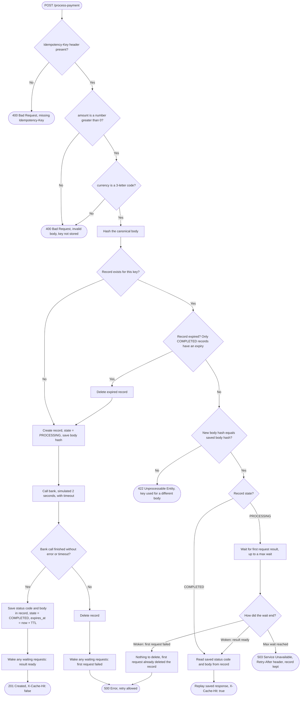

# Silk Idempotency Gateway

A payment-processing API that guarantees each payment is charged **at most once**, no matter how many times a client retries the same request.

Clients send a unique `Idempotency-Key` header with every payment. The first request with a key is processed and its response is saved. Any retry with the same key and the same body gets the saved response back instantly, without charging again.

## Architecture

### Request flow

Every path starts when a request arrives and ends with exactly one HTTP response.



### Shapes

| Shape | Meaning |
|---|---|
| Oval | Start or end of the flow (a request arrives, or a response is sent) |
| Diamond | A decision; each outgoing arrow is labelled with an answer |
| Rectangle | An action the server performs |

### What is stored for each key

```
key -> {
    state:      PROCESSING or COMPLETED
    body_hash:  SHA-256 of the canonical request body
    response:   saved status code and body (COMPLETED only)
    expires_at: when the record can be forgotten (COMPLETED only)
}
```

A record moves through these states:

- **PROCESSING**: a charge for this key is happening right now. It has no expiry, because forgetting it mid-charge could allow a second charge. It always ends within the bank timeout, either by becoming COMPLETED or by being deleted on failure.
- **COMPLETED**: the result is saved and replayed to any retry. Its expiry clock starts here.
- **Expired or deleted**: the key is treated as never seen.

### Cases handled

| # | Situation | Response |
|---|---|---|
| 1 | No `Idempotency-Key` header | `400`, nothing stored |
| 2 | Invalid body (amount missing or not greater than 0, currency not a 3-letter code) | `400`, key not stored so the client can fix the body and reuse the key |
| 3 | New key, or a key whose record has expired | Store as PROCESSING, call the bank (simulated 2 seconds), save, `201` with `X-Cache-Hit: false` |
| 4 | Known key, different body (any state) | `422` "Idempotency key already used for a different request body." |
| 5 | Known key, same body, COMPLETED | Replay the saved status code and body with `X-Cache-Hit: true`, no delay |
| 6 | Known key, same body, still PROCESSING | Wait for the first request's result, then replay it with `X-Cache-Hit: true` |
| 7 | Error during processing, including the bank call timing out | Delete the record, `500`, so a retry gets a fresh attempt |
| 8 | A waiting request (case 6) whose first request fails | `500`; the first request has already deleted the record, so the retry starts fresh |
| 9 | A waiting request (case 6) reaches its maximum wait | `503` with a `Retry-After` header; the record is kept so the retry finds the result |
